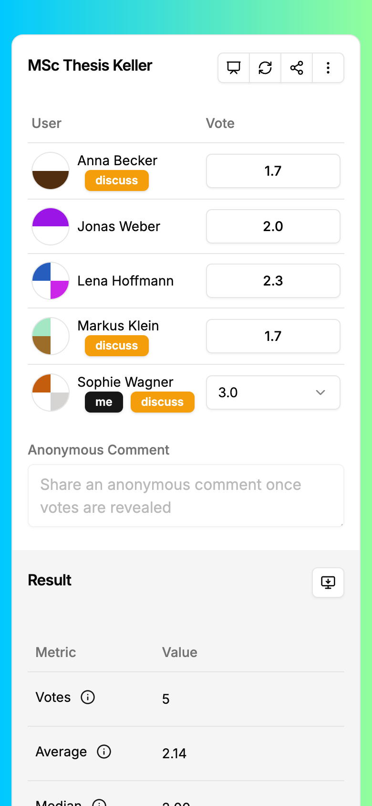
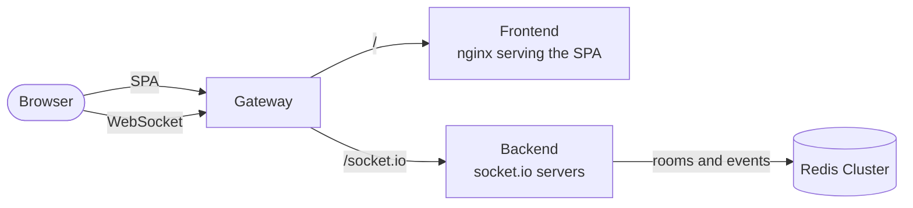

# gradingpoker.stoetz.ms

Planning poker for grading: examiners vote on a grade in secret, reveal all votes at once and discuss the differences.

| Voting | Result | Phone |
|---|---|---|
|  |  |  |


## Usage

1. **Join:** enter a room and a user name (or keep the generated ones) and join. Share the room with the share button.
2. **Vote:** pick a grade (1.0 to 5.0), a proposal verdict (Passed, Rework, Failed) or a general option (Supervisor, Withhold, Viewer). Your vote stays hidden until the votes are revealed.
3. **Comment (optional):** write a comment. It is revealed together with the votes and stays anonymous.
4. **Reveal:** anyone clicks **Show Votes**. The result shows the count, average, median, most frequent vote and the distribution, and can be downloaded as YAML.
5. **Discuss:** the users with the most opposite votes get a **discuss** badge.
6. **Next round:** **Hide Votes** hides them again; changing a vote does too.

**Presentation mode** (screen icon) hides your own vote and comment field, for sharing your screen.


## Architecture



- **Frontend:** a single-page app (Remix, React) served by nginx. It only talks to the backend over one WebSocket (socket.io, no long-polling), so any backend replica can serve any client without sticky sessions.
- **Backend:** stateless Node.js servers (socket.io). All state is in Redis, so any backend can serve any room.
- **Rooms:** a room is a few Redis hashes (users, votes, comments, and a version that increases with every change). Every operation is one small script that Redis runs atomically: a vote writes that user's vote and nothing else. So operations never wait for each other or conflict, and cost the same in small and large rooms.
- **Updates:** a change is published in the same step as it is written, as an event with its version, on the room's own channel (Redis sharded pub/sub). A backend subscribes to the rooms it has users in and forwards the events to them. A client gets the full state when it joins and applies events afterwards.
- **No missed updates:** a client only applies the event that is exactly one version ahead; if it sees a gap, it asks for the full state. A backend also tells its clients the current version of their room at a fixed interval (heartbeat, every 5 seconds by default, see `STOETZMS_GRADING_POKER_HEARTBEAT`), which catches a missed last update. Reconnecting always loads the full state.
- **Avatars:** drawn by the client from the user name, so the same name has the same avatar everywhere and the server stores none.
- **High availability:** Kubernetes restarts and replaces backends through `/healthz` and `/readyz`; a backend that shuts down marks its users as offline, and they reconnect to another replica and take over their seat by their browser session. Redis is a Redis Cluster: rooms are spread over the masters, and when a master fails its replica takes over within seconds, during which only the rooms on that master reject changes. Redis replicates asynchronously and keeps the rooms in memory only (the volume of a node only holds its cluster membership), so a failover can lose the last writes, and losing a master together with its replica loses their rooms.
- **Scaling:** add backend replicas for more connections and Redis masters for more rooms (`backend.replicas` and `redis.replicaCount` in the chart). Backend and frontend can also scale with their CPU load (`autoscaling`, off by default). PodDisruptionBudgets keep node drains from taking down more than one backend, frontend or Redis node at a time.
- **Limits:** each connection may send 30 requests per 30 seconds; names are at most 64 and comments at most 500 characters.
- **Anonymous comments:** the author of a comment never leaves the backend. Clients get the comments only after the reveal, as texts sorted alphabetically.

## Dev 

Start the development environment and access the app at http://localhost.

```
docker compose -f docker-compose.dev.yaml up -d
```

Alternatively, run backend and frontend directly (the vite dev server proxies `/socket.io` to `http://localhost:3000`). The backend needs a Redis on `localhost:6379`.

```
docker run -d --rm --name gradingpoker-redis -p 6379:6379 redis:8.0
cd backend && pnpm dev
cd frontend && pnpm dev
```


## Tests

Backend tests need a Redis (`TEST_REDIS_HOST` and `TEST_REDIS_PORT`, by default `localhost:6379`).

```
docker run -d --rm --name gradingpoker-test-redis -p 16379:6379 redis:8.0
cd backend && TEST_REDIS_PORT=16379 pnpm test
```

Frontend unit tests:

```
cd frontend && pnpm test
```


## Release

Pull requests and merges to `main` run the checks (`.github/workflows/ci.yaml`).

Pushing a tag `v<version>` runs the checks and then publishes that version (`.github/workflows/release.yaml`):

- the images `ghcr.io/milesstoetzner/stoetzms-gradingpoker:backend-<version>` and `:frontend-<version>`,
- the Helm chart `oci://ghcr.io/milesstoetzner/charts/gradingpoker` in the same version, which uses those images by default.

```
git tag v1.0.0 && git push origin v1.0.0
```


## Configuration

Environment variables of the backend (in the chart: `backend.env`).

| Variable                              | Default  | Description                                                                                   |
|---------------------------------------|----------|-----------------------------------------------------------------------------------------------|
| `STOETZMS_GRADING_POKER_OFFLINE_GRACE` | `600`    | Seconds a user who lost the connection keeps their seat and vote, and can reconnect into them |
| `STOETZMS_GRADING_POKER_ROOM_TTL`      | `604800` | Seconds without changes after which a room is deleted (7 days)                                |
| `STOETZMS_GRADING_POKER_HEARTBEAT`     | `5`      | Seconds between the heartbeats that tell clients the current version of their room            |

Environment variables of the frontend (in the chart: `frontend.impressumUrl` and `frontend.privacyUrl`).
A link is only shown below the join card if its variable is set.

| Variable                               | Description                                                                       |
|----------------------------------------|-----------------------------------------------------------------------------------|
| `STOETZMS_GRADING_POKER_IMPRESSUM_URL` | URL of your existing Impressum page (the page with the operator's name and contact) |
| `STOETZMS_GRADING_POKER_PRIVACY_URL`   | URL of your existing privacy policy                                               |


## Production

Deploy the Helm chart with your own values (host, Gateway and so on, see `chart/values.yaml`).

```
helm upgrade --install gradingpoker oci://ghcr.io/milesstoetzner/charts/gradingpoker --version <version> --namespace gradingpoker --create-namespace -f values.yaml
```

Do not pass `--wait` on the first install: the Redis Cluster is formed in a hook after the install, and the backends only become ready once it exists.
