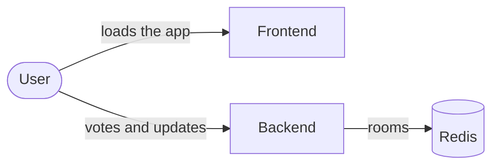

# gradingpoker.stoetz.ms

Planning poker for grading: examiners vote on a grade in secret, reveal all votes at once and discuss the differences.

| Voting | Result | Phone |
|---|---|---|
|  |  |  |


## Features

- **Secret voting:** everyone votes hidden, and all votes are revealed at once.
- **Grading modes:** grades from 1.0 to 5.0, proposal verdicts (Passed, Rework, Failed) and general options (Supervisor, Withhold, Viewer).
- **Result:** count, average, median, most frequent vote and distribution, downloadable as YAML.
- **Discussion hint:** the users with the most opposite votes are marked to discuss.
- **Anonymous comments:** revealed together with the votes, without names.
- **Presentation mode:** hides your own vote and comment, for sharing your screen.
- **Simple setup:** no registration and nothing to create up front. Enter a room and a user name, and share the room as a link.
- **Phones and tablets:** the room adapts to small screens.


## Usage

1. **Join:** enter a room and a user name (or keep the generated ones) and join. Share the room with the share button.
2. **Vote:** pick your vote. It stays hidden until the votes are revealed.
3. **Comment (optional):** write a comment. It is revealed together with the votes and stays anonymous.
4. **Reveal:** anyone clicks **Show Votes** to see the result.
5. **Discuss:** the users with the most opposite votes get a **discuss** badge.
6. **Next round:** **Hide Votes** hides them again.


## Architecture



- **Stateless backends:** all rooms live in Redis, so any backend can serve any user of any room.
- **Atomic changes:** every change of a room is one atomic step.
- **Events:** every change is published to everyone in the room. A client loads the room once and applies the changes afterwards.
- **No missed updates:** changes are numbered. A client that notices a gap, or learns from the regular heartbeat that it is behind, loads the room again.
- **Reconnect:** a user who loses the connection keeps their seat and vote.
- **High availability:** every component runs replicated. If a backend fails, its users reconnect to another one and keep their seat. If a Redis node fails, its replica takes over.
- **Rooms are not saved to disk:** Redis keeps them in memory only. If a Redis node fails, the changes made right before can be lost.
- **Scaling:** more backends serve more users, more Redis nodes hold more rooms.


## Dev 

Start the development environment and access the app at http://localhost.

```
docker compose -f docker-compose.dev.yaml up -d
```

Alternatively, run backend and frontend directly (the vite dev server proxies `/socket.io` to `http://localhost:3000`). The backend needs a Redis on `localhost:6379`.

```
docker run -d --rm --name gradingpoker-redis -p 6379:6379 redis:8.0
cd backend && pnpm dev
cd frontend && pnpm dev
```


## Tests

Backend tests need a Redis (`TEST_REDIS_HOST` and `TEST_REDIS_PORT`, by default `localhost:6379`).

```
docker run -d --rm --name gradingpoker-test-redis -p 16379:6379 redis:8.0
cd backend && TEST_REDIS_PORT=16379 pnpm test
```

Frontend unit tests:

```
cd frontend && pnpm test
```


## Release

Pull requests and merges to `main` run the checks (`.github/workflows/ci.yaml`).

Pushing a version tag (without a leading `v`) runs the checks and then publishes that version (`.github/workflows/release.yaml`):

- the images `ghcr.io/milesstoetzner/stoetzms-gradingpoker:backend-<version>` and `:frontend-<version>`,
- the Helm chart `oci://ghcr.io/milesstoetzner/charts/gradingpoker` in the same version, which uses those images by default.

```
git tag 1.0.0 && git push origin 1.0.0
```


## Configuration

Environment variables of the images, and the chart values that set them. Other backend variables can be set through `backend.env`.

| Variable                               | Chart value             | Default  | Description                                                              |
|----------------------------------------|-------------------------|----------|--------------------------------------------------------------------------|
| `STOETZMS_GRADING_POKER_OFFLINE_GRACE` | `backend.offlineGrace`  | `600`    | Backend: seconds a user who lost the connection keeps their seat and vote |
| `STOETZMS_GRADING_POKER_ROOM_TTL`      | `backend.roomTtl`       | `604800` | Backend: seconds without changes after which a room is deleted (7 days)   |
| `STOETZMS_GRADING_POKER_HEARTBEAT`     | `backend.heartbeat`     | `5`      | Backend: seconds between the heartbeats that tell clients the current version of their room |
| `STOETZMS_GRADING_POKER_IMPRESSUM_URL` | `frontend.impressumUrl` | not set  | Frontend: URL of your existing Impressum page, linked below the join card if set |
| `STOETZMS_GRADING_POKER_PRIVACY_URL`   | `frontend.privacyUrl`   | not set  | Frontend: URL of your existing privacy policy, linked next to it if set  |


## Production

Deploy the Helm chart with your own values (host, Gateway and so on, see `chart/values.yaml`).

```
helm upgrade --install gradingpoker oci://ghcr.io/milesstoetzner/charts/gradingpoker --version <version> --namespace gradingpoker --create-namespace -f values.yaml
```

Do not pass `--wait` on the first install: the Redis Cluster is formed in a hook after the install, and the backends only become ready once it exists.
