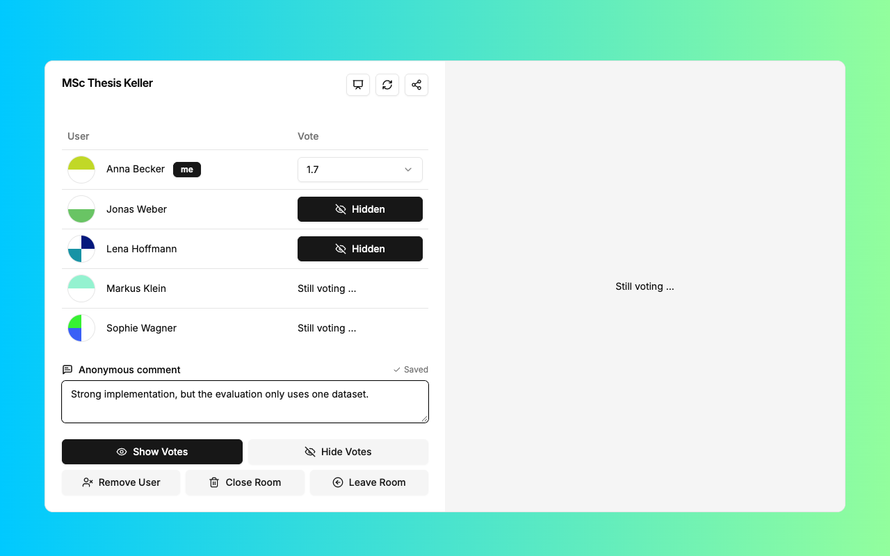

# gradingpoker.stoetz.ms

- https://github.com/milesstoetzner/stoetzms-gradingpoker

Planning poker for grading: examiners vote on a grade in secret, reveal all votes at once and discuss the differences.

| Voting | Result | Phone |
|---|---|---|
|  |  |  |


## Usage

1. **Join:** enter a room and a user name (or keep the generated ones) and join. Share the room with the share button.
2. **Vote:** pick a grade (1.0 to 5.0), a proposal verdict (Passed, Rework, Failed) or a general option (Supervisor, Withhold, Viewer). Others only see that you voted.
3. **Comment (optional):** write an anonymous comment. It is shown without your name once votes are revealed and cannot be changed while they are shown.
4. **Reveal:** anyone clicks **Show Votes**. The result shows the count, average, median, most frequent vote and the distribution, and can be downloaded as YAML. The users with the most opposite votes get a **discuss** badge.
5. **Next round:** **Hide Votes** hides them again; changing a vote does too.

Also:

- **Presentation mode** (screen icon) hides your own vote and comment field, for sharing your screen.
- **Remove User** removes someone else, **Close Room** ends the room for everyone, **Leave Room** only for you.
- If you lose the connection, your seat and vote are kept for 10 minutes and you are back in when you reconnect.
- Rooms without changes for 7 days are deleted.


## Architecture

```
browser ── WebSocket ──> Gateway ──> backend (2 replicas) ──> Redis (3 instances + Sentinel)
        └─ static files ─────────> frontend (2 replicas)
```

- **Frontend:** a single-page app (Remix, React) served by nginx. It only talks to the backend over one WebSocket (socket.io, no long-polling), so any backend replica can serve any client without sticky sessions.
- **Backend:** stateless Node.js servers (socket.io). All state is in the store: `memory` for development, `redis` for production. The socket.io Redis adapter forwards room broadcasts between the replicas.
- **Rooms:** one record per room (users, votes, comments, a version). Every change is sent to the room as the full state with its version, and clients ignore states older than the one they have.
- **Consistency:** every operation on a room is atomic without locks. The backend reads the room, changes a copy and writes it only if the room is still at the version it read (one compare-and-set script in Redis); otherwise it starts over. Clicks give up after 3 attempts ("Room is busy"), joins and housekeeping retry longer.
- **High availability:** Kubernetes restarts and replaces backends through `/healthz` and `/readyz`; a backend that shuts down marks its users as offline, and they reconnect to another replica and take over their seat by their browser session. Redis Sentinel promotes a replica when the Redis master fails, and the backends ask the Sentinels for the current master. Redis replicates asynchronously and stores nothing on disk, so a failover can lose the last writes, and losing all Redis instances loses the open rooms.
- **Limits:** each connection may send 30 requests per 30 seconds; names are at most 64 and comments at most 500 characters.
- **Anonymous comments:** the author of a comment never leaves the backend. Clients get the comments only after the reveal, as texts sorted alphabetically.

## Dev 

Start the development environment and access the app at http://localhost.

```
docker compose -f docker-compose.dev.yaml up -d
```

Alternatively, run backend and frontend directly (the vite dev server proxies `/socket.io` to `http://localhost:3000`).

```
cd backend && pnpm dev
cd frontend && pnpm dev
```


## Tests

Backend integration tests run against the in-memory store and, if `TEST_REDIS_PORT` is set, also against Redis.

```
docker run -d --rm --name gradingpoker-test-redis -p 16379:6379 redis:8.0
cd backend && TEST_REDIS_PORT=16379 pnpm test
```

Frontend unit tests:

```
cd frontend && pnpm test
```


## Release

Build the release image.

```
./build-and-push.sh
```


## Configuration

The frontend image reads the following environment variables at container startup.
A link is only shown if its variable is set.

| Variable                               | Description                                      |
|----------------------------------------|--------------------------------------------------|
| `STOETZMS_GRADING_POKER_IMPRESSUM_URL` | URL of the Impressum linked below the join card  |
| `STOETZMS_GRADING_POKER_PRIVACY_URL`   | URL of the privacy policy linked next to it      |


## Production

Install or upgrade the Helm chart with the commit tag printed by `./build-and-push.sh`.
Settings such as the host, the Gateway to attach to, replicas and the Impressum/privacy URLs are in `chart/values.yaml`.
Redis runs with Redis Sentinel from the [CloudPirates Redis chart](https://github.com/CloudPirates-io/helm-charts/tree/main/charts/redis), a dependency of the chart.

```
helm dependency build ./chart
helm upgrade --install gradingpoker ./chart --namespace gradingpoker --create-namespace --set image.tag=<tag>
```